

<header>
  <h1 style="border-bottom: none;">Goblett: Seamless Private Voting</h1>
  
Made for UBC Hackathon 2026

</header>

 

## Intro

[Goblett](https://goblett.xyz) is the first zero-trust on-chain voting system on Arc, using the [Semaphore Protocol](https://semaphore.pse.dev/) 
and OHTTPS to mask on and off-chain identities and a first of its kind Web2 relay protocol that requires no trust or gas from 
registered wallets.

Every existing crypto voting system requires either some level of trust in a coordinator (GAMI), are straight-up just not anonymous
(Polymesh), or in the best case require voters to create burner wallets on every election and, to attain the level of anonymity of Goblett, fund that wallet through privacy cryptocurrencies (which voters hardly ever do).

Goblett cuts through all of these drawbacks by being USDC native, having no coordinator privileges, and relying only on wallet
signatures and locally stored secretes, while maintaining minimal drawbacks (see limitations + mitigants).

## Core Architecture

### Semaphore

The Semaphore Protocol is a cryptographic protocol for masking group identity. Simply put, group members can send commitments
to Semaphore from their whitelisted addresses (or with some other open proof of membership), and then from another address
prove their membership to the group without revealing what commitment they know the secrete for. The technicals of it are 
explained quite succinctly [HERE](https://docs.semaphore.pse.dev/technical-reference/circuits).

### Goblett

The main limitation that comes with Semaphore is that though group membership is masked, the secondary wallet is fully traceable.
In the case of elections, this means it would be fairly easy to deduce which main wallet corresponds to which secondary one based off
IP and election overlap. To achieve complete anonymity, you would need to create and secretely fund a new burner wallet for every
election, and use Tor for any transactions from burner wallets.

Goblett kills three birds with one stone by having an oblivious funded relayer forward both registrations and votes to the on-chain 
election. The relayer listens to a [Nostr](https://nostr.org/) topic, so no Web2 endpoint needs to be trusted, and cannot modify
ballots without invalidating the proof. Additionally, anyone can set up a Goblett relayer, and is rewarded for doing so by receiving
refund of gas paid plus a bounty from the contract (which is funded upon creation), so no relayer is trusted.

During the registration phase of a Goblett election, users sign a nullifier and commitment hashed from their Semaphore secrete and send 
it through an [OHTTP](https://en.wikipedia.org/wiki/Oblivious_HTTP) to the Nostr topic tagged `goblett-<chain id>` (5042 for Arc),
where it is then test-proved by a relayer before being forwarded to the election. After the registration ends, the same is then done
for the vote, this time proved with Semaphore. A nullifier is necessary, as not being able to tell where the vote came paired with the
nondeterministic Semaphore proofs means without it voters could send infinitely many votes otherwise. At the end of the voting phase, 
anyone can then see who got the most votes and a consensus is made.

Arc is used because its lack of fluctuation in both its native token ($USDC) and its gas fees mean that every election costs the same
every time, and election contracts can't be underfunded. Semaphore was not yet on Arc, so we needed to deploy our own copies. The
novelty of Arc causes no drawbacks, since voters can sign and register with any secrete key (since they never actually touch the 
blockchain).

### Semaphore Deployments:

&nbsp;&nbsp;&nbsp;&nbsp;&nbsp;&nbsp; Arc testnet:  &nbsp; [0x78e50FBA810bb1496c8C1c5209F491AB1Aa8a743](
  https://explorer.testnet.arc.io/address/0x78e50FBA810bb1496c8C1c5209F491AB1Aa8a743)

&nbsp;&nbsp;&nbsp;&nbsp;&nbsp;&nbsp; Arc mainnet: [0x21F9ee5fbA61be8755E49eE7Cb7F679077429482](
  https://explorer.arc.io/address/0x21F9ee5fbA61be8755E49eE7Cb7F679077429482?tab=txs)

### Relayer: 

We have one relayer pointed at both the testnet and mainnet Arc Nostr topics, deployed running the
scripts in [/relayer](https://github.com/Niccolo-Bal/goblett-relayer/tree/main). Anyone is free to deploy their own.

&nbsp;&nbsp;&nbsp;&nbsp;&nbsp;&nbsp; Arc testnet: &nbsp; [0x89D659eaA0Ff1E7527582D795bAaA4b43b168ee5](
  https://explorer.testnet.arc.io/address/0x89D659eaA0Ff1E7527582D795bAaA4b43b168ee5)

&nbsp;&nbsp;&nbsp;&nbsp;&nbsp;&nbsp; Arc mainnet: [0x89D659eaA0Ff1E7527582D795bAaA4b43b168ee5](
  https://explorer.arc.io/address/0x89D659eaA0Ff1E7527582D795bAaA4b43b168ee5)

### Why not use wallets for semaphore identities?

This seems appealing, as it removes the need for the registration period (commitments are addresses, secretes are private keys), and was
actually the initial idea for the project. However, Metamask and every other wallet has no native support for making semaphore proofs, 
only signatures (which tie to the address). So doing this would require users to copy their private keys directly onto the website, 
which is a huge security risk.

## Front-End Implementation

Goblett is hosted live at [goblett.xyz](https://goblett.xyz). The site is plain HTML, CSS and JavaScript built with Vite, in a white
liquid-metal style: chrome tokens and buttons with a blue glow, over frosted-glass cards. Users log in with MetaMask or with email; email
sign-in creates a Circle user-controlled wallet that stays within the browser, sacrificing no security.

For deploying elections, we host our own faucet [0xCc516e2aBC427fa846DC37148966e76471f3428b](https://explorer.testnet.arc.io/address/0xCc516e2aBC427fa846DC37148966e76471f3428b) for testnet elections, and have an Arc onramp for mainnet elections to make the deployment
process more convenient.

### Pages

- **Landing** (`index.html`): a short calling card around the liquid-metal ballot token. First-time visitors get a guided intro, a
  terminal that "runs" a private vote and then hands over to the token, which explains each step.
- **Why Goblett** (`why.html`): a scroll story that follows one ballot from registration to the public count. The page stays pinned
  while scrolling drives eight scenes, so it plays in reverse when you scroll back up. Then why a secret ballot matters, how Goblett
  compares with a show of hands, an online form and a typical on-chain vote, and what the design does not hide. (`privacy.html`
  redirects here.)
- **App** (`app.html`): sign-in, your elections, each election's page, and the create flow.

### Using the app

Once signed in, you see the elections your wallet is whitelisted for. Registering shows a voter key being made and added to the voter list; voting shows the ballot being
sealed into a token and dropped into the ballot box. Ballots are routed through an OHTTP relay that hides your IP address, and the
tally is visible on Arc as soon as a vote is counted.

To start an election you set a title, who's on the ballot, a timeline and the whitelisted wallets, then fund it with a USDC transfer.
The tally is visible the whole time. Elections run on Arc Testnet or Arc Mainnet: Testnet is free but has no security guarantees, while
Mainnet costs USDC and has security and permanence guarantees.

The biggest addition planned after the hackathon is Apple Pay and debit card support for the Arc on-ramp. It isn't in yet only because
it needs an approval that takes several days.

### Gallery

Scenes from the Why Goblett page, in the order they appear.

<table>
  <tr>
    <td width="50%">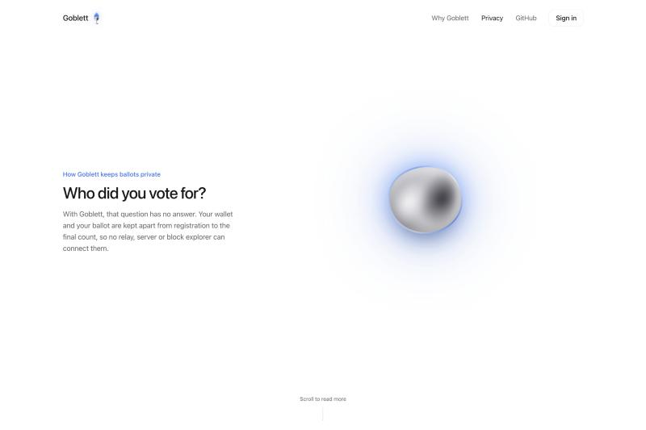 The opening screen: your wallet and your ballot are kept apart from start to finish</td>
    <td width="50%">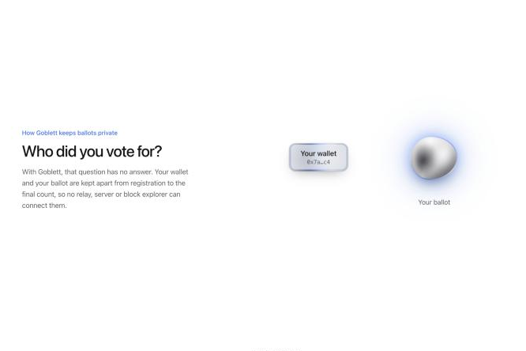 The ballot token splits away from the wallet</td>
  </tr>
  <tr>
    <td width="50%">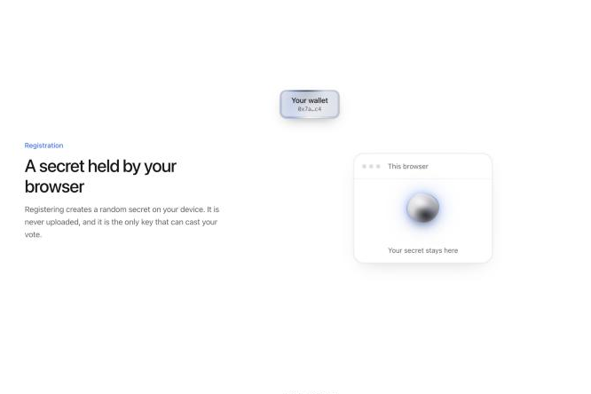 Registering creates a secret that never leaves the browser</td>
    <td width="50%">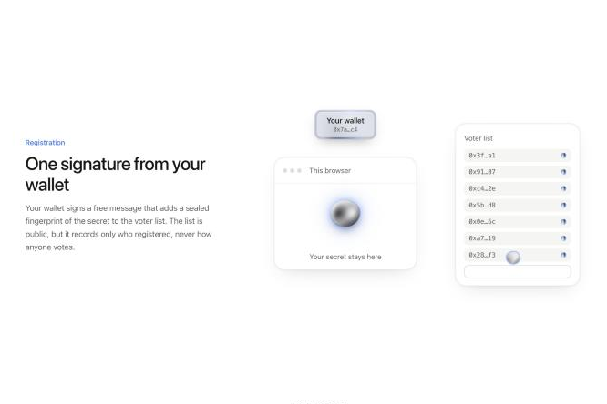 One wallet signature adds a sealed copy of the secret to the voter list</td>
  </tr>
  <tr>
    <td width="50%">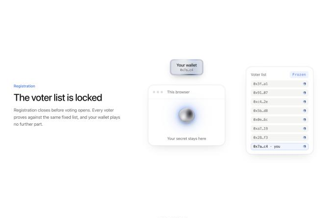 The voter list freezes before voting opens</td>
    <td width="50%">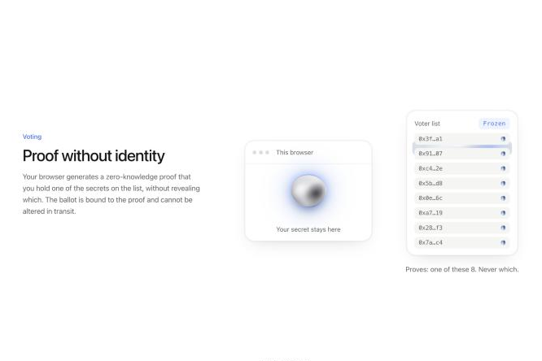 A zero-knowledge proof shows you are on the list, never which entry</td>
  </tr>
  <tr>
    <td width="50%">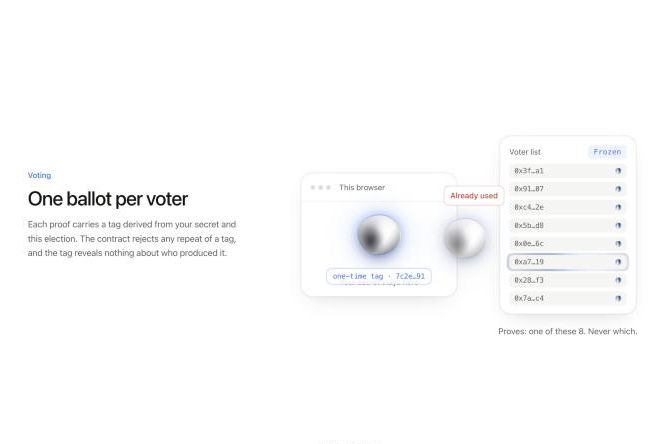 A one-time tag turns away a second ballot</td>
    <td width="50%">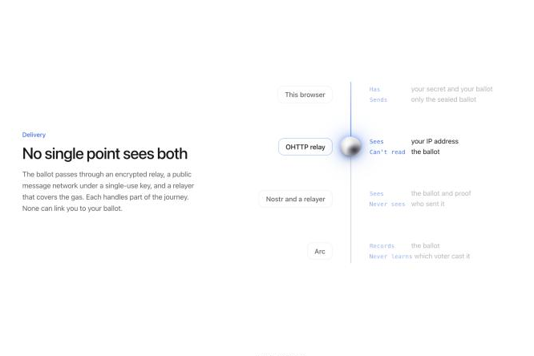 The OHTTP relay sees your IP address but can't read the ballot</td>
  </tr>
  <tr>
    <td width="50%">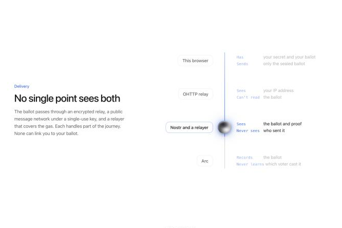 Nostr and the relayer see the ballot and proof, never who sent it</td>
    <td width="50%">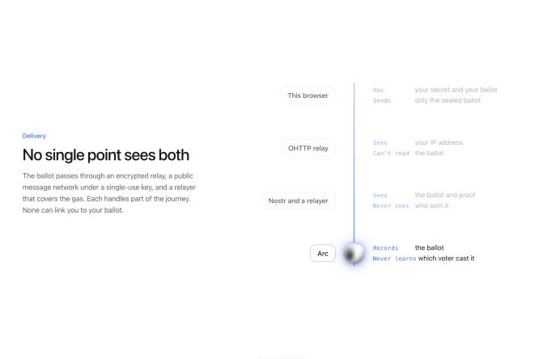 Arc records the ballot without learning which voter cast it</td>
  </tr>
  <tr>
    <td width="50%">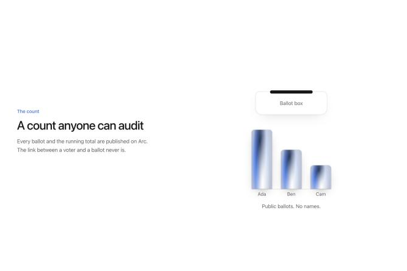 Ballots and the count are public; the voter behind each ballot is not</td>
    <td width="50%">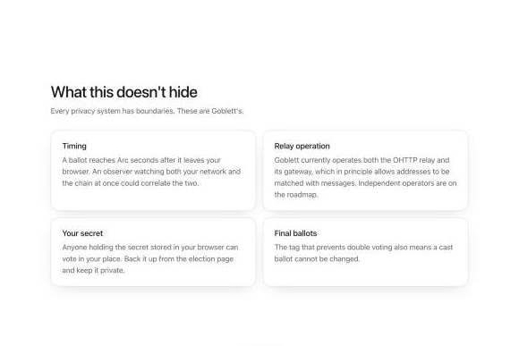 What the design does not hide, stated plainly</td>
  </tr>
  <tr>
    <td width="50%">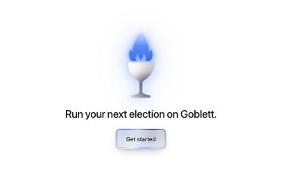 The closing mark: the goblet…</td>
    <td width="50%">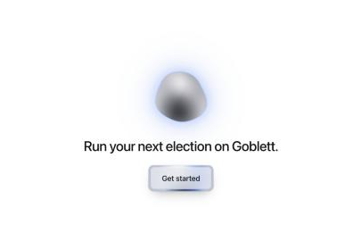 …melts into the liquid-metal ballot token and back</td>
  </tr>
</table>

## Limitations + Mitigants

### Cannot Change Votes

This is the biggest structural issue. By having nullifiers, and allowing only allowing users to submit their vote once
(which is needed, since we cannot identify identities at vote time by construction). In most online voting systems,
this is seen as a necessity to avoid collusion. In reality, it doesn't impact anonymity or security at all, but is important to
note.

A workaround is to shorten the window for voting, and then have relayers or voters wait until that window till they actually input
their vote (which they placed in advance), which would have the same effect as allowing multiple votes in terms of avoiding collusion.
We chose not to take that approach for this hackathon.

### Nostr Opens Vulnerabilities

This is the only open vulnerability, and is a fairly weak one. Attackers could spam the topic with pointless messages or 
false proofs, leading to what could amount to many false expensive checks for relayers. Most Nostr nodes have some level
of IP or pubkey rate limit though, so the problem would largely fix itself. A coordinated attack is still a
possible risk. This only impacts the Web2 portion of Goblett, the DApp would remain unaffected.

### Unencrypted Votes

Votes are signed and cannot be modified without changing the proof, but contain the vote unencrypted. This means 
that if you can tie a voter to a vote (or to a specific time), you can tie them to who they voted for. GAMI and other
systems get around this by having a trusted party decrypt the votes and then publishing results with an sk-SNARK proof, 
but this solution and other similar ones require trust. However, tieing a voter to a vote is already a breach of security,
so for an airtight system, this doesn't arise as an issue.   

### Gap Between Vote + Registration

It is kind of annoying to have a seperate registration and voting phases, especially when the window from election creation 
to closure is tight.

### OHTTP Not Truly Oblivious

The current OHTTP setup uses a relayer run by us, so we could hypothetically pair IPs with unencrypted messages.

The fix for this would be to have a third party or many parties run the relayer, which would be possible to implement with more time.

### Email and Google Sign-In Go Through Our Server

Signing in without a wallet extension uses Circle's wallets, and those requests pass through the site's server, so we
see the email, the wallet and the IP together. Voting identities are still random and stay in the browser, so this
never links a voter to a vote. Use a wallet extension to avoid it.

## Grok Bot Usage (for SpaceXSI Bounty)

Grok Bot was used consistently throughout the project primarily to check for vulnerabilities. A team of three
specialist bots ("Red," "Blue," and "Scout") worked together to uncover several vulnerabilities at each step 
of the project that were not found initially by devs or coding agents. See `AUDIT_REPORT.md`.

 

 

 

<em>Made by Niccolo Balestriere et al. from Blockchain@Emory</em>
 
 

